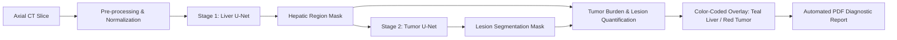

# HepaVision 🏥
### Intelligent Liver & Tumor Detection from Abdominal CT Scans using Deep Learning and Computer Vision

[](https://www.python.org/)
[](https://tensorflow.org/)
[](https://flask.palletsprojects.com/)
[](https://opencv.org/)
[](https://www.reportlab.com/)
[](https://www.docker.com/)

**HepaVision** is an end-to-end Computer-Aided Diagnosis (CAD) application for automated hepatic lesion segmentation, tumor burden quantification, and clinical reporting from abdominal Computed Tomography (CT) scans. It implements a two-stage cascaded U-Net deep learning pipeline coupled with anatomical tissue refinement and automated diagnostic PDF generation.

---

## 🌟 Key Features

- **Cascaded Two-Stage U-Net Architecture:**
  - **Stage 1 (`liver_unet.keras`):** Isolates and segments hepatic tissue from abdominal axial CT slices.
  - **Stage 2 (`tumor_unet.keras`):** Localizes and segments focal lesion/tumor regions within the identified liver parenchyma.
- **Adaptive Segmentation & Tissue Refinement:** Employs soft-tissue Hounsfield contrast calibration and morphological filtering to ensure consistent, robust organ boundary delineation across varied scanner protocols.
- **Objective Clinical Quantification:**
  - Hepatic tissue volume / pixel area
  - Tumor lesion volume / pixel area
  - **Tumor Burden Percentage** ($\frac{\text{Tumor Area}}{\text{Liver Area}} \times 100$)
  - Connected-component lesion counting and focal clustering
  - Ground-truth evaluation via **Dice Similarity Coefficient (DSC)**
- **Diagnostic PDF Generation:** Automatically compiles segmentation overlays, clinical metrics, patient metadata, and medical disclaimers into a standardized, hospital-ready PDF report via ReportLab.
- **Modern Clinical Radiologist UI:** Premium dark-mode glassmorphism interface with live pipeline step animations, scan previews, and history tracking.

---

## 🖥️ System Architecture & Methodology



---

## 📂 Project Structure

```
hepavision/
├── app.py                      # Flask backend, inference pipeline, PDF generation
├── train_liver_tumor_unet.py   # Complete U-Net training pipeline (LiTS 256x256)
├── requirements.txt            # Python dependencies
├── Dockerfile                  # Container definition for cloud deployment
├── .dockerignore               # Docker ignore rules
├── models/
│   ├── liver_unet.keras        # Stage 1: Liver segmentation model weights
│   ├── tumor_unet.keras        # Stage 2: Tumor segmentation model weights
│   └── tumor_unet_roi.keras    # Stage 2 variant: ROI tumor segmentation
├── templates/                  # Jinja2 frontend views
│   ├── _public_base.html       # Landing shell
│   ├── _app_base.html          # Radiologist dashboard shell
│   ├── home.html               # Project overview & hero
│   ├── login.html              # Access portal
│   ├── dashboard.html          # Model telemetry & recent cases
│   ├── analysis.html           # CT scan upload & live pipeline
│   ├── report.html             # Diagnostic report viewer
│   └── about.html              # Methodology & research documentation
└── static/
    ├── style.css               # Medical glassmorphism design system
    ├── script.js               # Client interactivity & pipeline animation
    ├── uploads/                # Cached patient CT scan inputs
    ├── predictions/            # Generated liver, tumor, and overlay masks
    └── reports/                # Generated diagnostic PDF reports
```

---

## 🚀 Quick Start (Local Setup)

### Prerequisites
- Python 3.10 – 3.13
- Git

### 1. Clone the Repository
```bash
git clone https://github.com/kaysavpiranavp18/hepavision.git
cd hepavision
```

### 2. Create a Virtual Environment & Install Dependencies
```bash
# Windows
python -m venv venv
venv\Scripts\activate

# Linux / macOS
python3 -m venv venv
source venv/bin/activate

pip install -r requirements.txt
```

### 3. Run the Application
```bash
python app.py
```
Open your browser and navigate to **[http://localhost:5000](http://localhost:5000)**.

---

## 🐳 Docker Deployment

To build and run with Docker:

```bash
# Build the container
docker build -t hepavision .

# Run the container on port 5000
docker run -p 5000:5000 hepavision
```

---

## 🧠 Model Training

The models were designed for training on the **LiTS (Liver Tumor Segmentation Challenge)** 256×256 axial benchmark dataset (`sodko3/lits-dataset-liver-and-tumor-segmentation-256x256`).

To train new models using the included pipeline:
```bash
# Full training on GPU (local or Kaggle)
python train_liver_tumor_unet.py --data-root /path/to/lits_dataset --mixed-precision

# Quick test run on CPU
python train_liver_tumor_unet.py --data-root /path/to/lits_dataset --max-slices 500 --epochs-liver 2 --epochs-tumor 2 --out-dir models
```

---

## 📡 REST API Reference

| Endpoint | Method | Description | Parameters |
| :--- | :--- | :--- | :--- |
| `/` | `GET` | Home landing page | None |
| `/dashboard` | `GET` | Telemetry & recent analyses | None |
| `/analysis` | `GET` | Interactive CT analysis interface | None |
| `/predict` | `POST` | Runs segmentation & metric pipeline | `ct_image` (multipart/form-data), `ground_truth` (optional) |
| `/download_report/<filename>` | `GET` | Downloads generated medical PDF report | `filename` (string) |
| `/health` | `GET` | Service & model availability check | None |

---

## 📄 License & Academic Disclaimer

This project is released under the **MIT License**.

> [!CAUTION]
> **Research and Educational Prototype Only:** HepaVision is developed for computational research and academic demonstration purposes. It is not approved by the FDA, CE, or equivalent medical authorities for diagnostic or therapeutic use. Clinical decisions should always be made by qualified medical professionals.
